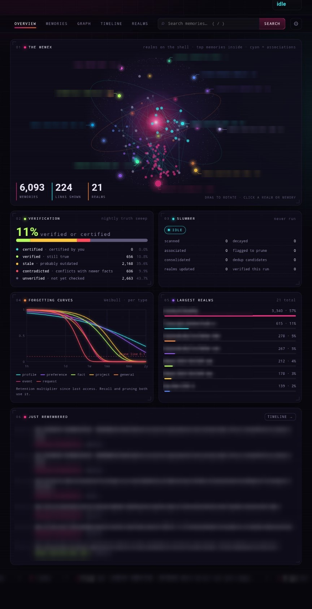
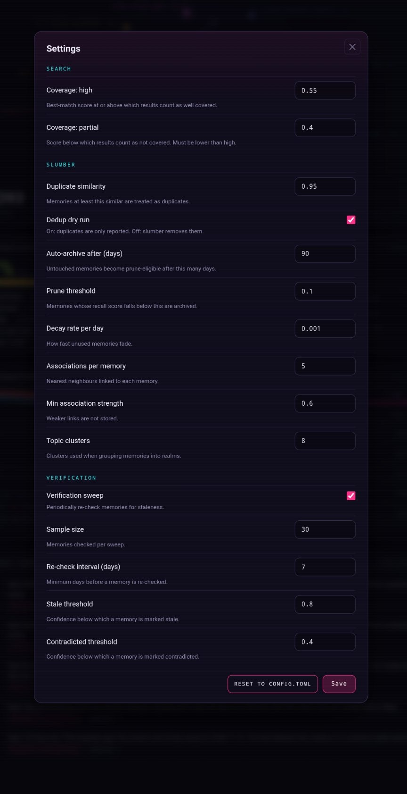

# memex8 — Human-Like Memory for AI Agents

A self-hosted memory system that models how **human memory actually works**: memories fade over time at *different rates depending on what they are*, queries re-weight themselves based on *what the user is actually asking for*, related ideas connect automatically, and scattered fragments consolidate into dense summaries. Powered by Google's **TurboQuant** algorithm via [**TurboVec**](https://github.com/RyanCodrai/turbovec) for 8x compressed vector storage.

```
┌──────────────────────┐     ┌────────────────────────────┐     ┌──────────────────────┐
│   AI Agent (Hermes)   │────▶│       memex8 Engine         │────▶│     Qdrant DB        │
│   or any MCP client   │◀────│  Weibull decay (per-type)   │◀────│  payload/metadata    │
└──────────────────────┘     │  Query intent weighting     │     └──────────────────────┘
                             │  Associations + slumber     │
                             │  TurboVec (vectors)         │
                             └────────────────────────────┘
                                      │
                                      ▼
                             ┌──────────────────────┐
                             │     Web UI Graph      │
                             │  memory visualization │
                             └──────────────────────┘
```

**[⭐ Star on GitHub](https://github.com/Ex8-ca/memex8) · [Report Issue](https://github.com/Ex8-ca/memex8/issues)**

## Screenshots

<table>
  <tr>
    <td width="33%"><a href="docs/screenshots/overview.jpg"></a></td>
    <td width="33%"><a href="docs/screenshots/graph.jpg"></a></td>
    <td width="33%"><a href="docs/screenshots/settings.jpg"></a></td>
  </tr>
  <tr>
    <td align="center"><b>Overview</b><br>the Memex, verification, slumber, forgetting curves</td>
    <td align="center"><b>Graph</b><br>associations, coloured by realm</td>
    <td align="center"><b>Settings</b><br>edit server tunables behind your login</td>
  </tr>
</table>

<sub>Taken from a real instance on a phone; memory text and realm names are redacted.</sub>

**Jump to:** [Quick Start](#quick-start) · [Signing in](#signing-in) · [Settings editor](#settings-editor) · [Network exposure](#network-exposure) · [Hermes integration](#hermes-agent-integration) · [REST API](#rest-api) · [Troubleshooting](#troubleshooting)

## Shared memory for Hermes, Claude Code, and Codex

Use one memex8 server from **Hermes Agent, Claude Code, and Codex**, on the same
computer or across computers on your **local network**. All clients connect to
the same authenticated REST API and share the same memory database.

- **Hermes Agent:** native memory provider with automatic recall, conversation
  capture, and memory-write mirroring.
- **Claude Code and Codex:** a local stdio MCP bridge provides project-scoped
  memory search, explicit memory saving, and agent/session/device attribution.
  The bridge provides tools; it does not automatically archive whole conversations.
- **Obsidian:** optional read-only vault search and note references let agents
  consult the current Markdown source alongside stored memories.

For example, run memex8 once at `http://192.168.1.50:8080`, then connect Hermes
on your desktop, Claude Code on a laptop, and Codex on another computer using
the same API key. Use matching project IDs across bridge clients. Each computer
needs its own bridge installation; Obsidian lookup needs a local or mounted
vault maintained by your existing sync process.

See the [LAN setup guide](integrations/shared-memory/LAN.md) for all three clients,
the [MCP bridge guide](integrations/shared-memory/README.md) for its tools, and
the [backup and recovery guide](docs/BACKUPS.md) before upgrading an existing server.

## Install as a Hermes Agent plugin

memex8 ships a `plugins/memex8/` directory that turns it into a drop-in memory
backend for [Hermes Agent](https://hermes-agent.nousresearch.com/). Once the
plugin is in the Hermes catalog, installation is one command:

```bash
hermes plugins install memex8
hermes memory setup       # pick "memex8", enter URL + API key
```

The plugin is a **standalone third-party plugin** and is intentionally NOT in
the hermes-agent `plugins/memory/` in-tree directory — see the
[Hermes plugin policy](https://hermes-agent.nousresearch.com/docs/developer-guide/plugins)
for why (memex8 evolves fast and Nous doesn't own it). Promoted in the Nous
Research Discord `#plugins-skills-and-skins` channel.

What's wired up:

- **Auto-recall** before each turn (background semantic search → injected context)
- **Auto-sync** of conversation turns (skips trivial replies)
- **Session-end ingestion** of the full conversation summary
- **Memory-write mirroring** of Hermes' built-in `memory` tool calls
- **Pre-compress checkpoint** (Hermes memory-provider API v2) — archives the
  full transcript before lossy context rewrites; opt-in fail-closed via
  `compression.checkpoint_required: true`

See [`plugins/memex8/README.md`](plugins/memex8/README.md) for full setup.

---

## Why This Exists

Most AI memory systems treat every stored fact as equally important forever, and every search query the same way. That's not how memory works. memex8 models five real cognitive behaviors:

1. **You forget things at different rates** — your preferences age slowly, the events of last Tuesday age fast. Per-type Weibull decay reflects this.
2. **Related things connect** — semantic associations form automatically during nightly slumber
3. **Fragments become summaries** — raw conversations consolidate into dense memories
4. **You ask different questions differently** — "what happened last week" wants recency, "what does marc prefer" wants importance. Query intent classification re-weights accordingly.
5. **Memory is plastic** — memories get re-classified, re-weighted, and re-connected over time as the system understands them better

The result: an AI agent that remembers what matters, forgets what doesn't, answers *the question you're actually asking*, and connects related ideas without manual tagging.

---

## Key Features

### 🧠 Memory Evolution (What Makes This Different)

| Feature | What It Does | Source |
|---------|-------------|--------|
| **Per-type Weibull decay** | Untouched memories fade on a memory-type-specific curve. `preference` (k=0.4, scale=6mo), `fact` (k=0.8, ~1mo), `event` (k=1.2, ~1wk), `request` (k=1.5, ~3 days). Floor at 0.05 — nothing is ever fully deleted. Ported from Mnemosyne's WEIBULL_PARAMS table. | `src/engine/decay.rs` |
| **Query intent classification** | Search queries are classified into one of {temporal, factual, preference, procedural, entity, general}. Each intent re-weights the result scoring: "what happened last week" boosts recency, "what does marc prefer" boosts importance, "how do I deploy" boosts vector similarity. Regex-based, no LLM call on the search path. | `src/engine/query_intent.rs` |
| **Memory verification** | Nightly sweep samples memories and rates confidence they're still true. Stale/contradicted memories rank lower in recall but never disappear. | Slumber phase 13 |
| **Recoverable consolidation** | Summaries record provenance; durable source archives support undo with original IDs and metadata. | REST, MCP, Hermes |
| **Certified memories** | User-confirmed memories retain their content and importance through automatic maintenance. Certification skips consolidation, pruning, decay, session reweighting, and verification. | REST, MCP, Hermes |
| **Semantic associations** | During nightly slumber, each memory links to its 5 nearest neighbors by vector similarity. | Slumber phase 9 |
| **Spreading activation** | Recalling a memory bumps its associated memories too. Like how "Tesla" primes "Skar speakers". | `Engine::recall()` |
| **Consolidation** | Raw conversation fragments merge into dense summaries. 98 scattered snippets → 5 clean summaries. | Slumber phase 7 |

### Memory Type Reference

Every memory carries a `memory_type` field that determines its decay rate. New memories are typed at ingestion; legacy memories can be retroactively classified with `scripts/classify_memory_types.py` (see below).

| Type | Decay shape (k, scale) | Behavior |
|------|----------------------|----------|
| `profile` | (0.30, 1yr) | Long-term stable — user identity, facts about the person |
| `preference` | (0.40, 6mo) | Long-term stable — likes, dislikes, habits |
| `relationship` | (0.35, 1yr) | Long-term stable — people, connections |
| `fact` | (0.80, 1mo) | Medium-term — general knowledge |
| `entity` | (0.50, 6mo) | Medium-term — named things |
| `setup` | (0.60, 3mo) | Medium-term — configs, endpoints, infra |
| `decision` | (1.00, 2wk) | Decays after the decision is acted on |
| `commitment` | (1.00, 10d) | Decays fast — deadlines |
| `event` | (1.20, 1wk) | Fast-decay — things that happened |
| `instruction` | (0.90, 20d) | Decays — how-to knowledge goes stale |
| `error` | (1.10, 2wk) | Medium-fast — bug descriptions |
| `request` | (1.50, 3d) | Fastest — most requests become irrelevant quickly |
| `general` | (1.00, 1wk) | Default for untyped memories |

### 🔧 Core

- **Rust binary** with embedded web UI — single deployable artifact
- **Qdrant** for payload storage and metadata filtering
- **TurboVec** ([RyanCodrai/turbovec](https://github.com/RyanCodrai/turbovec)) — Google's TurboQuant algorithm for compressed vector search. 8x compression, zero training, data-oblivious, faster than FAISS on ARM
- **Auto-discovered realms** — memories self-organize into knowledge clusters
- **File watching** — real-time directory monitoring, auto-reingest on change
- **3D force-directed graph** — interactive visualization of memory associations
- **MCP server** — works with Claude Code, Opencode, and any MCP-compatible agent
- **REST API** — full CRUD + search with auth and pagination, plus PATCH for partial updates
- **Reaction tracking** — upvote/downvote memories to reinforce or suppress importance
- **Semantic associations** — auto-generated links between related memories (FillGap, TemporalNext, Prerequisite, Companion)
- **Knowledge gap detection** — slumber phase identifies underexplored topic areas
- **Proactive inference API** — suggests what to explore based on existing knowledge
- **Session-end extraction** — LLM-powered summary of decisions and follow-ups from conversations

### 🔌 Embedding Providers

| Provider | Model | Dimensions | Notes |
|----------|-------|------------|-------|
| **OpenAI** | `text-embedding-3-small` | 1536 | Fast, accurate, cloud-based |
| **OpenAI-compatible** | Any | Any | MiniMax, Together AI, Groq — configure `base_url` for cost savings |
| **Ollama** | `nomic-embed-text` | 768 | Fully local, zero cost, sovereign |

### 💤 Slumber Consolidation

Nightly "sleep" pipeline (13 phases): deduplicate → **TurboQuant compression** → re-cluster realms → rename/merge realms → prune stale → **LLM consolidation** → index optimization → spreading activation → **associate memories** → **detect gaps** → **session review** → prune empty realms → **memory verification**.

| Backend | Model | Notes |
|---------|-------|-------|
| **OpenAI** | `gpt-4o-mini` | Default, cheap, no GPU needed |
| **Local** | Any OpenAI-compatible endpoint | Fully private consolidation |
| **TurboQuant** | 4-bit compression | 8x vector size reduction, data-oblivious, 0 training |

---

## Quick Start

### Prerequisites

- Docker & Docker Compose v2 (`docker compose`, not `docker-compose`)
- OpenAI API key *(or Ollama for fully local embeddings, see [Local embeddings](#local-embeddings-ollama))*
- A few GB of free disk. By default the first `docker compose up` compiles the Rust binary inside Docker (a few minutes); or use the [prebuilt image](#3-run) (linux/amd64) and skip the build
- **Your user must be able to talk to the Docker daemon.** Either:
  - Add yourself to the `docker` group: `sudo usermod -aG docker $USER`, then log
    out and back in (or `newgrp docker` for the current shell), **or**
  - Use [Docker rootless](https://docs.docker.com/engine/security/rootless/).
  - Verify with `docker info` — if it errors on `/var/run/docker.sock`, the
    install is broken before memex8 even starts.

### 1. Clone

```bash
git clone https://github.com/Ex8-ca/memex8.git
cd memex8
```

### 2. Configure

Copy the template and fill in only the secrets memex8 actually needs.
The narrow env file keeps every other Hermes secret (other model keys,
A2A tokens, …) out of the container.

```bash
cp .env.memex8.example .env.memex8
chmod 600 .env.memex8
$EDITOR .env.memex8
```

Copy the config template too. `docker-compose.yml` mounts `./config.toml`
read-only, and it is not in the repo (it is git-ignored so your edits stay local):

```bash
cp config.example.toml config.toml
```

> **Skipping this breaks startup.** If `./config.toml` does not exist, Docker
> creates a *directory* with that name and memex8 then fails to read its
> config. If that already happened: `rm -rf config.toml && cp config.example.toml config.toml`.

Generate a strong `MEMEX8_API_KEY` with:

```bash
python3 -c "import secrets; print(secrets.token_urlsafe(32))"
```

The only required entries are:

```bash
MEMEX8_API_KEY=<output from the command above>
OPENAI_API_KEY=sk-...        # or leave empty + set EMBEDDING_PROVIDER=ollama
# OPENAI_BASE_URL=...        # optional: OpenAI-compatible API (MiniMax, Together, Groq)
# EMBEDDING_PROVIDER=ollama  # optional: use local embeddings
```

> **Security:** previously the shipped `docker-compose.yml` mounted
> `~/.hermes/.env` directly, which exposed *every* Hermes secret to the
> memex8 container. The shipped compose now defaults to the project-local
> `.env.memex8` instead. See [#10](../../issues/10) for details.

### 3. Run

```bash
docker compose up -d
docker compose ps        # wait until memex8 shows "healthy" (the first run builds the image: a few minutes)
```

**Faster: prebuilt image.** Releases publish `ghcr.io/ex8-ca/memex8` (linux/amd64; tags like `0.2.0`, `0.2` and `latest`). Layer the override file to pull it instead of building:

```bash
docker compose -f docker-compose.yml -f docker-compose.ghcr.yml up -d
# pin a version: MEMEX8_VERSION=0.2.0 in .env  (default: latest)
```

On arm64 (Apple silicon, Raspberry Pi) build from source with plain `docker compose up -d`.

Memories and the search index live in Docker volumes (`qdrant_data`,
`memex8_data`), and a daily digest is written to `~/.memex8/` on the host.

#### Local embeddings (Ollama)

To avoid sending text to OpenAI, run Ollama alongside memex8. In
`.env.memex8` set:

```bash
EMBEDDING_PROVIDER=ollama
EMBEDDING_MODEL=nomic-embed-text
EMBEDDING_DIMENSIONS=768
OLLAMA_URL=http://ollama:11434
```

then start with the `local-embeddings` profile and pull the model once:

```bash
docker compose --profile local-embeddings up -d
docker compose exec ollama ollama pull nomic-embed-text
```

Choose your embedding model *before* storing memories: vectors from different
models or dimensions are not interchangeable.

### 4. Verify

```bash
# Without an API key, every /api/v1 request returns 401 (fail-closed).
# See issue #11.
curl -i http://localhost:8080/api/v1/memories
# HTTP/1.1 401 Unauthorized
# Missing Authorization header

# With the key you generated in step 2:
curl -i -H "Authorization: Bearer $MEMEX8_API_KEY" http://localhost:8080/api/v1/memories
# HTTP/1.1 200 OK

# Health is always public (no key required)
curl http://localhost:8080/health
# OK
```

### 5. Open the Web UI

```
http://localhost:8080
```

Sign in with a username and password (see [Signing in](#signing-in)), or paste
your `MEMEX8_API_KEY` under *Settings → Advanced* if password login is off.

> **Note:** `MEMEX8_API_KEY` is **required** when running `memex8 serve`.
> The server refuses all `/api/v1` requests with `401 Unauthorized` when
> the key is unset (fail-closed). For local development only, pass
> `--allow-no-api-key` to start the server without it — the warning logs
> will be loud on purpose. See [#11](../../issues/11) for context.

**Web UI features:** an Overview dashboard ("The Memex": a rotating sphere of realms, top memories and association links; verification breakdown; last slumber report; per-type Weibull forgetting curves; largest realms; just-remembered feed and live ticker), a Timeline scrubber built on `/api/v1/memories/timeline`, semantic search with the coverage verdict, realm filtering, a force-directed association graph that shows link strength on hover, a memory detail view with retention-now, verification, "why it's linked" neighbours, upvote/downvote and delete, and a Settings editor for server tunables. The page is a single self-contained file with no external fonts or CDNs.

### Signing in

Instead of pasting the API key into every browser, the UI can use a username and
password. Add both to `.env.memex8`:

```bash
# make a hash (the password is read from stdin, 8+ characters)
printf '%s' 'your-password' | docker run --rm -i --entrypoint memex8 <memex8-image> hash-password
# or, with a local binary:  printf '%s' 'your-password' | memex8 hash-password

MEMEX8_WEB_USER=alice
MEMEX8_WEB_PASSWORD_HASH='$argon2id$v=19$m=19456,t=2,p=1$...'   # single quotes: the hash contains $
```

Recreate the container and the UI shows a sign-in screen. Details:

- Passwords are stored only as an **argon2id** hash. A successful login sets a signed, `HttpOnly`, `SameSite=Strict` session cookie valid for 30 days (it also gets `Secure` when a reverse proxy sends `X-Forwarded-Proto: https`).
- The `Authorization: Bearer` API key keeps working, so Hermes, the MCP bridge and other agents need no changes. The cookie is simply accepted as an alternative.
- Five failed sign-ins in a minute lock login for the rest of that minute.
- Rotating `MEMEX8_API_KEY` or changing the password signs everyone out.
- *Settings → Sign out* ends the session. Login is off unless both variables are set.

> **Plain HTTP:** the password and cookie cross your network unencrypted unless
> you put memex8 behind HTTPS or Tailscale. See [Network exposure](#network-exposure).

### Settings editor

*Settings* (the gear) edits 15 validated tunables for **search coverage**,
**slumber** (dedup, archive, prune, decay, associations, topic clusters) and
**verification**. It sits behind the same login as the rest of the UI.

- `config.toml` is mounted read-only, so edits are saved to a `settings.toml` on the data volume (next to the TurboVec index) and merged over `config.toml` at startup.
- Changes apply after a restart. *Restart now* exits the process and the container's `unless-stopped` policy brings it back; each field shows *running* vs *pending* until then.
- *Reset to config.toml* deletes the overrides file.
- Values are range-checked, and cross-field rules hold (for example `coverage.partial < coverage.high`). An invalid or unparsable `settings.toml` is ignored with a warning, so a bad save can never stop the server from starting.
- Secrets, URLs, paths and ports are **not** editable here.

### Network exposure

Inside Docker memex8 must listen on all interfaces, so who can reach it is set
by the *host* side of the published ports (8080 web/API, 8081 MCP). That is the
`MEMEX8_BIND_ADDR` variable in the compose `.env` (default `0.0.0.0`):

```bash
scripts/set-bind.sh                 # show the current setting
scripts/set-bind.sh local --apply   # 127.0.0.1: this machine only
scripts/set-bind.sh tailscale --apply  # this machine's Tailscale IP only
scripts/set-bind.sh lan --apply     # every interface (default)
scripts/set-bind.sh 192.168.1.50 --apply # one specific IPv4 address
```

`--apply` recreates the memex8 container (about 15–30 seconds; data is
untouched). Without it the value is only written to `.env`.

---

## Hermes Agent Integration

This is the primary use case — memex8 replaces Hermes' built-in memory system entirely.

### Install the Plugin

```bash
mkdir -p ~/.hermes/plugins
cp -r ~/memex8/plugins/memex8 ~/.hermes/plugins/
```

### Configure

Add to `~/.hermes/config.yaml`:

```yaml
memory:
  provider: "memex8"
  memory_enabled: true
```

### Add to SOUL.md

The plugin handles the technical integration — but your SOUL.md is what tells Hermes to actually *use* memex8. Without this, Hermes has the plugin installed but no behavioral instruction to check it.

Add this to `~/.hermes/SOUL.md`:

```markdown
## Memory

You have persistent memory across sessions via **memex8**.

**First, read `~/.memex8/memex8.md`** before each session — it contains:
- Daily slumber digests (dates, summaries of what was worked on)
- Top memories by importance
- How to use the memex8 tools

**To save new memories**, use memex8_remember. Include:
- Topic — what was worked on
- Decisions made — choices agreed upon
- New facts discovered — environment info, API quirks, user preferences
- Code patterns established — conventions, architecture choices, workflows
- Problem solutions found — bugs fixed with how they were resolved
- Follow-ups needed — anything left incomplete or to revisit

Format as a single structured entry. Skip trivial sessions.

> **session_search** = raw conversation history  
> **memex8** = curated takeaways
```

> 💡 **Why this matters:** config.yaml enables the capability — SOUL.md directs the behavior. Both are needed for memex8 to work reliably across sessions.

### What Happens Automatically

| Trigger | Action |
|---------|--------|
| Before each turn | Background recall → injected as context |
| After each turn | Conversation facts stored as memories |
| Session ends | Full conversation summary sent via webhook |
| Trivial messages | Skipped ("ok", "thanks" aren't stored) |

### Available MCP Tools

`memex8_search` · `memex8_remember` · `memex8_recall` · `memex8_realms` · `memex8_forget` · `memex8_get`

**How scoring works under the hood:**

- **`memex8_recall`** — scores by `importance × decay(age, memory_type)`. Each memory's Weibull decay is computed from its `memory_type` and `last_accessed`. Preferences age slow, events age fast, etc. Touches bump importance on access.
- **`memex8_search`** — vector similarity first, then re-weighted by the inferred intent of the query. Temporal queries boost recency, preference queries boost importance, procedural queries boost vector similarity. Falls back to balanced weighting when intent is unclear.

Both endpoints run through the same Weibull + intent logic, so the answer to "what did marc decide yesterday" is appropriately different from "what does marc prefer."

---

## Retroactive Memory Type Classification

Every memory carries a `memory_type` field that drives its decay rate. New memories are typed at ingestion via the `ExtractedItem.memory_type` field. To classify existing memories (the ones that shipped before the field existed, currently `general` by default):

```bash
cd ~/memex8

# 1. Preview what would change (no writes)
LLM_API_URL=https://api.openai.com \
LLM_MODEL=gpt-4.1-mini \
OPENAI_API_KEY=sk-... \
python3 scripts/classify_memory_types.py --dry-run

# 2. Apply for real
LLM_API_URL=https://api.openai.com \
LLM_MODEL=gpt-4.1-mini \
OPENAI_API_KEY=sk-... \
python3 scripts/classify_memory_types.py
```

The script runs in two passes:

1. **Keyword classifier** — fast regex match on content for obvious signals (`like/prefer/favorite` → `preference`, ISO dates → `event`, `wife/husband/friend` → `relationship`, `my name/I am/I live` → `profile`, `port/host/url/env var/docker` → `setup`, `error/bug/broken/crash` → `error`, `decided/going with` → `decision`, `how to/step/install` → `instruction`)
2. **LLM fallback** — sends keyword-miss memories to your configured chat model with a small classification prompt. Falls back to `general` if no `LLM_API_URL` is set.

**Confidence handling:** if neither pass is confident, the memory stays `general` (safe default with k=1.0, 1wk decay). **Slumber-summary memories** (`chunk_type=consolidated`) are auto-skipped — they're already abstract combinations of multiple memories.

**Cost:** roughly **$0.01 per 1,000 memories** with `gpt-4.1-mini`. Keyword-only mode is free.

The script writes via the new `PATCH /api/v1/memories/{id}` endpoint, which accepts `{memory_type, importance}` for surgical updates.

---

## CLI Reference

```bash
memex8 init          # Interactive setup wizard
memex8 ingest ./docs # Ingest files or directories
memex8 watch add .   # Persistent file watcher
memex8 search "query" # Semantic search
memex8 recall        # Wakeup context (top memories)
memex8 slumber status # Slumber status
memex8 slumber inspect-duplicates # Read-only candidate report; skips all other phases
memex8 slumber trigger # Run maintenance now
memex8 doctor        # Diagnose issues
memex8 serve         # Start REST API server
memex8 hash-password # Hash a web-login password (reads stdin) for MEMEX8_WEB_PASSWORD_HASH
memex8 mcp           # Start MCP server
memex8 stats         # System statistics
```

---

## REST API

### Memories & Realms

| Method | Endpoint | Description |
|--------|----------|-------------|
| `GET`  | `/api/v1/memories` | List all memories (sort: `ingested_at`, `importance`, `last_accessed`, `access_count`) |
| `POST` | `/api/v1/memories` | Store a new memory |
| `GET`, `POST` | `/api/v1/memories/search` | Semantic search |
| `GET`  | `/api/v1/memories/recall` | Top memories |
| `GET`  | `/api/v1/memories/verification-summary` | Count memories by verification status (certified/verified/stale/contradicted/unverified) |
| `POST` | `/api/v1/memories/{id}/certify` | Certify a memory; optional body `{ "by": "marc", "note": "Confirmed" }` |
| `DELETE` | `/api/v1/memories/{id}/certify` | Revoke certification and resume normal lifecycle |
| `GET` | `/api/v1/memories/timeline` | Compact chronological neighbors around a memory, query, or time |
| `POST` | `/api/v1/memories/batch-get` | Get 1–50 full memories in requested order; report unavailable IDs |
| `POST` | `/api/v1/dedup/{operation_id}/restore` | Restore a removed duplicate from its journal |
| `POST` | `/api/v1/memories/{id}/unconsolidate` | Restore consolidation sources, then remove the summary; safe to retry |
| `GET`  | `/api/v1/memories/{id}` | Get memory by ID, including provenance |
| `PATCH` | `/api/v1/memories/{id}` | Partial payload update — accepts `{memory_type, importance}`. Used by the retroactive classifier script |
| `DELETE` | `/api/v1/memories/{id}` | Delete memory |
| `GET`  | `/api/v1/realms` | List realms |
| `POST` | `/api/v1/slumber/trigger` | Trigger slumber |
| `GET`  | `/api/v1/health` | Health check (no auth) |

### Web login & settings

| Method | Endpoint | Description |
|--------|----------|-------------|
| `POST` | `/auth/login` | Body `{ "username", "password" }`; sets the session cookie (no API key needed) |
| `POST` | `/auth/logout` | Clear the session cookie |
| `GET`  | `/auth/me` | `{ "login_enabled", "authenticated" }` |
| `GET`  | `/api/v1/settings` | Editable tunables with running and pending values |
| `PUT`  | `/api/v1/settings` | Body `{ "values": { "slumber.auto_archive_days": 21 } }`; validated, saved to `settings.toml` |
| `DELETE` | `/api/v1/settings` | Discard saved overrides |
| `POST` | `/api/v1/settings/restart` | Restart the server so saved settings apply |

`/api/v1/*` accepts either the Bearer key or a valid session cookie.

### Reactions & Associations

| Method | Endpoint | Description |
|--------|----------|-------------|
| `POST` | `/api/v1/memories/{id}/react` | Upvote or downvote a memory |
| `GET`  | `/api/v1/memories/{id}/associations` | Get semantic links for a memory |

### Proactive Inference

| Method | Endpoint | Description |
|--------|----------|-------------|
| `GET`  | `/api/v1/inference/gaps` | List open knowledge gaps |
| `POST` | `/api/v1/inference/suggest` | Get gap suggestions for a topic |
| `POST` | `/api/v1/inference/gaps/{id}/resolve` | Mark a gap as resolved |
| `POST` | `/api/v1/inference/gaps/{id}/dismiss` | Dismiss a gap |

### Certified memories

Store with `{"content": "Confirmed fact", "certified": true}` when the user explicitly
asks to remember or confirm it. Omitted `certified` defaults to false. MCP and Hermes
expose `memex8_remember(..., certified=true)` and
`memex8_certify(memory_id, revoke=false, by="marc", note="Confirmed")`.
The existing Rust `memex8_store` tool supports the same flag.

Certification records `certified_at`, optional caller-provided `certified_by`, and
`certification_note`. Revocation clears these fields and resets verification to
`unverified`. Revoke before editing content or importing over an existing certified
point. Imports under new IDs preserve certification and provenance. Explicit user
deletion remains available. Realm movement, access tracking, and association/index
metadata can still update during normal operation.

Certification waits for active maintenance in the same process to finish. Automatic
importance and verification writes also check the current certification at Qdrant.
No extra configuration is required.

### Consolidation provenance and undo

Full memory retrieval includes `consolidated_from` (direct source IDs), `derived_by`,
`consolidated_at`, and `no_consolidate_until`. Content fingerprints in
`consolidated_evidence` let maintenance recognize already summarized evidence across
ancestry and overlapping groups, while changed content counts as new evidence.
Derived summaries and certified memories remain excluded from consolidation inputs.

Every consolidation saves complete typed source payloads and original vectors in the
Qdrant `consolidation_archive` collection, including when `preserve_originals=true`.
The journal records the embedding configuration at capture and vector dimensions.
Archive writes and summary writes are read back before any source deletion. The
journal ID is the summary ID and is logged when the archive becomes durable.

Call `POST /api/v1/memories/{id}/unconsolidate` or
`memex8_unconsolidate(memory_id)` in MCP/Hermes to undo a consolidation. Missing
sources are re-embedded with the current model and restored under their original
IDs with their archived metadata. Existing sources retain their current content and
metadata. All sources receive a consolidation cooldown of at least 30 days; longer
existing cooldowns are retained. The summary is removed only after every source and
its cooldown can be read back. A summary with edited content or certification returns HTTP 409;
revoke certification before undoing a certified summary. Missing summaries/journals
return 404. Older summaries can be undone when all their sources still exist;
lost sources without an archive produce a clear 409 error.

Journal states are `prepared`, `complete`, `restoring`, and `restored`. After an
interruption, retry with the same summary/journal ID, even when the summary is
missing. Partial restores keep the summary and journal. A completed retry returns
`already_restored=true` and does not recreate sources deliberately deleted afterward.
Undo invalidates the serving process's TurboVec cache and its persisted index files;
search uses Qdrant until a fresh index is built.

Archives remain in the data volume after undo and retain source content even after
normal memory deletion; there is no automatic archive cleanup in this release.
CLI backups now include `consolidations.json`, and restore accepts older backups
without that file. Restore refuses to overwrite a journal with different state;
use an isolated instance for an older backup. Docker volume backups include the
archive collection automatically.

Maintenance, certification, edit/import, payload changes, deletion, backup, and undo
coordinate within one process. Run maintenance/recovery through a single writer;
independent processes sharing Qdrant require external serialization. Qdrant filters
also recheck content, type, visibility, and certification immediately at deletion.
No new configuration keys are required.

### Compact retrieval

Use `memex8_search(query="...", compact=true)` or `memex8_recall(compact=true)`
for a small index, then `memex8_get(ids=["...", "..."])` to fetch the full memories
that matter. This pattern is available in both MCP transports and the Hermes tools.
The existing single-ID forms (`memory_id`, or legacy MCP `id`) still work; pass
exactly one of `memory_id`, `id`, or `ids`.

REST supports `compact: true` in the existing `POST /api/v1/memories/search` JSON
body, `compact=true` in `GET /api/v1/memories/search?query=...`, and
`GET /api/v1/memories/recall?compact=true`. The default is false, preserving full
result shapes and the existing pagination envelope. Compact rows contain only:

```json
{"id":"...","snippet":"...","realm_name":"...","score":0.8,"ingested_at":"...","memory_type":"fact","verification_status":"verified"}
```

Snippets use a nonblank summary when available, otherwise content, capped at 160
Unicode characters for either source. Search ranking, filters, pagination and access
tracking run through the same engine paths for full and compact results. This
reduces returned context; it does not avoid server-side payload retrieval or embedding.
Hermes automatic prefetch and injected context remain unchanged.

`POST /api/v1/memories/batch-get` accepts `{"ids":["...","..."]}` and returns
`{"memories":[...],"not_found":[...]}`. It makes one Qdrant batch request, preserves
the order and repetitions of found IDs, and reports missing/malformed UUIDs in
`not_found` in requested order. Empty batches and batches over 50 IDs are rejected.
Full payloads include source, visibility, certification, and provenance metadata.
The routes use the existing API authentication; batch retrieval has the same access
as authenticated single-memory retrieval.

The disposable long-body fixture measured 12,399 bytes for full search versus
1,575 bytes for compact search (12.7%) at the same result count. This measures
serialized UTF-8 JSON bytes, not tokens; savings depend on body and summary lengths.
No configuration changes or data migration are required.

### Memory timeline

Use `memex8_timeline(id="…", before=5, after=5)` to see what happened around a
memory, then `memex8_get(ids=[…])` for selected full bodies. Rust MCP and Hermes
also accept `query="…"` or `at="2026-11-08T00:00:00Z"`; pass exactly one anchor.
REST exposes the same parameters through `GET /api/v1/memories/timeline`.

`before` and `after` default to 5, each accepts 0–50, and optional `realm` and
`visibility` (`private` or `public`) scope both the anchor and its neighbors.
Query mode uses the top search hit with the existing 0.3 minimum score; a miss
returns `no_match=true`, no anchor, and an empty results list. Missing or
out-of-scope ID anchors return 404; a legacy anchor with an invalid stored
timestamp returns 409.

Responses contain `anchor_id`, `anchor_at`, `results`, `no_match`, and
`truncated`. Rows use the shared compact shape, UTC RFC3339 timestamps, and
`score=0` (chronological ordering). ID/query mode includes the anchor, even with
zero neighbors. Timestamp mode has no synthetic anchor: before is strictly
earlier, after includes memories at the specified time. Results sort by parsed
timestamp then ID, and return fewer rows at dataset edges.

Startup creates a Qdrant datetime index on `ingested_at`, including existing
collections. Timeline uses ordered range queries and paginated equal-time
buckets, with a fixed 10,000 fetched-row budget per request (boundary rereads
count). `truncated=true` means a partial result; nearest-neighbor completeness
is not guaranteed in that case. Legacy timestamps are normalized on output,
without rewriting stored payloads. Reads are best effort during concurrent
edits, rather than a database snapshot. ID/time anchors need no model calls;
query mode embeds once. No new configuration keys or prefetch changes.

### Search coverage

Every REST search response includes `coverage`, for full and compact rows, including
empty result sets and offset pages:

```json
{"coverage":{"level":"none","best_score":0.31,"results_above_min":0,"suggested_realms":["Projects"],"hint":"No strong retrieval match. Try broader terms, a suggested realm, or your configured digest."},"results":[],"total":0,"limit":10,"offset":0}
```

Coverage is a retrieval-strength heuristic; it does not establish whether the
sources can answer the query. `best_score` is the best raw cosine score among up
to 100 eligible Qdrant candidates, before `min_score`, ranking boosts and
pagination. It is null if there are no eligible candidates. `results_above_min`
counts matches meeting `min_score` in that bounded set, rather than a
collection-wide total or the size of the returned page. A high-coverage query can
therefore return an empty offset page or no rows under a stricter `min_score`.

Configure `[search.coverage] high = 0.55` and `partial = 0.40`; values must satisfy
`0 <= partial < high <= 1`. Missing sections/keys receive these defaults. Scores
at or above high give `high`, at or above partial give `partial`, otherwise `none`.
These are initial thresholds calibrated on deterministic known-hit/miss fixtures;
production embeddings and workloads may need different thresholds.

The same query embedding drives results, a payload-free raw Qdrant probe, and
realm-centroid scoring. Coverage uses that probe even when returned results use
TurboVec, so compressed ranking scores and verification/upvote/recency boosts do
not change its meaning. This adds a Qdrant search to the compressed retrieval path.
Realm suggestions rank valid centroids by cosine, return at most three names, and
check live members against realm, all requested tags, and visibility. Missing,
zero, incompatible, or orphan centroids are skipped; unavailable realm data omits
hints while retaining search results and coverage. Cached centroids can lag recent
writes until maintenance recomputes them.

REST search now applies combined realm/tag/visibility filters before Qdrant
candidate selection, and checks realm/visibility on TurboVec payloads. Rust MCP
and Hermes search expose the same optional tags and visibility filters. They print
`coverage=... best=... results_above_min=... try realms: ...` before result text and
retain the structured coverage metadata. Hermes can still use older servers
without coverage; automatic prefetch and injected context remain unchanged.

### Private-text redaction

Wrap text in `<private>...</private>` to exclude it from new memory capture:

```text
The project uses Rust. <private>temporary credential</private> Deployment is manual.
```

The stored/embedded text becomes `The project uses Rust. [private] Deployment is manual.`
Tags are case-insensitive and spans may cross lines. Nested spans remain private
until the outer tag closes. An opening tag without a closing tag hides the rest
of the input. Only the literal tag syntax is recognized; no attributes or escaping
syntax are supported.

One shared parser runs before direct storage, edits, file chunking/source hashing,
and session extraction. It retains state across conversation messages before the
session's last-50-message selection. Webhooks, watched-file re-ingestion, imports,
and LLM-derived summaries use the same rules. Textual metadata is sanitized as
well. The shared embedding factory applies redaction as a final boundary check;
Qdrant memory and archive writes reject still-marked payloads instead of pairing
modified content with an old vector. Provider error bodies are not logged or
returned, since an upstream service can echo sensitive input or output.

Whitespace/marker-only direct memories return HTTP 422 with
`content empty after redaction`. All-private files/chunks and imported records
are skipped with a safe diagnostic. All-private sessions return `status=skipped`,
a reason, and no stored IDs, without calling the LLM or embedder. Conversation
webhooks with no remaining meaningful content return 422. Imports re-embed any
body changed by redaction even when vector reuse was requested; metadata-only
changes can retain the existing vector.

Redaction applies to new capture and does not erase existing memories, original
files, backups, exports, or copies already sent elsewhere. Exact backup/recovery
paths reject marked legacy snapshots rather than silently changing archived
provenance or restoring mismatched vectors; use a sanitized regular import for
those records. Untagged secrets and paraphrases are not detected automatically.
The feature is always enabled, requires no configuration or migration, and does
not include configurable secret-pattern matching.

### Archived duplicate removal

`[slumber] dedup_dry_run = true` remains the default. In a full slumber run, setting
it to `false` enables actual exact/near-duplicate removal. The separate
`memex8 slumber inspect-duplicates` command always stays read-only, including when
that setting is false. Review its candidate report before enabling removal.
A full slumber still runs the other mutating maintenance phases when dedup dry run is enabled.

Each loser must match its retained winner directly using current original vectors,
the configured similarity threshold, and deterministic winner ordering. Removal
respects realm, visibility, `project:` tag scope, long-lived memory types,
certification, and recovery cooldowns. Two certified duplicates both survive.
A certified winner retains its content, importance, and certification; merging tags,
access counts, and provenance is allowed.

Before deletion, the full loser payload/vector and the winner's pre-merge payload
are saved and read back in `consolidation_archive` with `kind="dedup"`. The winner
receives the union of tags and ancestry (`consolidated_from`), evidence fingerprints,
and a journal marker in the same payload write. Per-original-ID access contributions
prevent repeated counting across retries, restored duplicates, and shared ancestry.
Existing derivation labels are retained; otherwise `derived_by` becomes `dedup`.
Full retrieval exposes `no_dedup_until`, `dedup_applied_operations`, and
`dedup_access_contributions` with backward-compatible defaults.
The source snapshot, pair eligibility, and original vectors are checked again
before removal. If an interrupted operation has changed, it is cancelled and its
archive retained. Pending prepared operations resume on the next enabled slumber.

Slumber reports distinguish `dedup_candidates`, actual `deduplicated`,
`dedup_skipped`, and `dedup_operation_ids`. Journal IDs are also logged as soon as
archiving succeeds, so partial failures remain recoverable. Find the last report at
`GET /api/v1/slumber/status`. Removal invalidates the serving process's TurboVec
cache/files; slumber rebuilds the disk index and search falls back to Qdrant.
Dangling graph edges and association IDs are removed with indexed lookups.

Restore a loser with `POST /api/v1/dedup/{operation_id}/restore` or
`memex8_restore_duplicate(operation_id)` in MCP/Hermes. Missing points are
re-embedded with the current model and restored under their original IDs; current
source edits and certification are retained. Both dedup and consolidation receive
at least a 30-day cooldown. Consolidation undo applies both cooldowns as well and
continues to work after a summary has received duplicate ancestry. Retry partial restores using the same operation ID.
Completed restores return `already_restored=true` without recreating points removed
later. The winner's current metadata is retained rather than subtracting historical
counts/tags from newer activity; contribution tracking prevents a later removal of
the restored identity from counting the same accesses twice.

Dedup journals use the existing archive retention and backup/restore rules above.
As with consolidation recovery, independent writers require external serialization.
This feature does not enable removal in an existing default configuration.

All endpoints (except `/health`) require `Authorization: Bearer *api_key*`.

---

## Architecture

```
memex8/
├── src/
│   ├── api/          # REST API (Axum) — CRUD, search, recall, PATCH
│   ├── engine/       # Core logic
│   │   ├── decay.rs         # Per-type Weibull decay (WEIBULL_PARAMS)
│   │   ├── query_intent.rs  # Regex classifier + intent weight biases
│   │   ├── embedder/        # OpenAI / Ollama / OpenAI-compatible
│   │   ├── chunker/         # Markdown AST → semantic chunks
│   │   ├── slumber/         # 13-phase nightly pipeline
│   │   ├── realms/          # Auto-discovered knowledge clusters
│   │   └── quantizer/       # TurboVec 4-bit compressed search index
│   ├── storage/      # Qdrant integration (payload/metadata only)
│   ├── mcp/          # MCP server (JSON-RPC 2.0)
│   └── web/          # Embedded web UI
├── scripts/          # One-shot maintenance scripts
│   ├── classify_memory_types.py  # Retroactive keyword+LLM classifier
│   ├── docker_backup.py          # Cold, verified backup + backup-gated upgrade
│   └── set-bind.sh               # Localhost-only vs all-interfaces (MEMEX8_BIND_ADDR)
├── plugins/memex8/   # Hermes plugin
├── docker-compose.yml
├── Dockerfile        # Multi-stage Rust build
└── config.example.toml
```

### Ingestion Pipeline

```
.md file → Chunker (pulldown-cmark AST) → Embedder (OpenAI/Ollama) →
Realm Assignment (cosine similarity) → Qdrant Store with memory_type →
TurboVec index (on slumber)
```

New memories are stamped with a `memory_type` at ingestion time (default `general`). The decay curve then drives recall ranking automatically — no manual weight tuning per memory.

### Recall Scoring

```
final_score = importance
              × weibull_decay(last_accessed, memory_type)
              × (1 + access_count × 0.05)
              × verification_multiplier
```

`weibull_decay()` is in `src/engine/decay.rs` — a pure function `(timestamp, query_time, memory_type) → f64` in `(0.0, 1.0]`. Defaults to the `general` curve for empty/unknown types.

### Search Scoring

```
raw_score = vector_similarity (cosine, after TurboVec fast-path)
adjusted  = raw_score
            × vector_bias[intent]
            × importance_factor(importance, importance_bias[intent])
            × recency_factor(decay, recency_bias[intent])
```

Intent weights come from `src/engine/query_intent.rs::weights_for(query)` — table of `(vector, importance, recency)` multipliers per intent class. Unclassified queries get the balanced default `(1.0, 1.0, 1.0)`.

### Slumber Pipeline (13 Phases)

```
Trigger → Deduplicate → TurboQuant Compress → Re-cluster → Rename/Merge →
Prune Stale → LLM Consolidation → Index Opt → Spreading → Associate → Gap Detect →
Session Review → Prune Empty Realms → Memory Verification
```

---

## Troubleshooting

**Container won't start:**
```bash
docker compose logs memex8
```

**`config.toml` is a directory / "Is a directory" on startup:**
You ran `docker compose up` before creating `config.toml`, so Docker made a directory in its place.
```bash
docker compose down
rm -rf config.toml && cp config.example.toml config.toml
docker compose up -d
```

**Can't reach the UI from another machine (or it is reachable from places you did not intend):**
The published ports follow `MEMEX8_BIND_ADDR` (default `0.0.0.0`, all interfaces). See [Network exposure](#network-exposure).

**Sign-in always says "invalid username or password":**
Check the hash survived. `docker exec <container> sh -c 'echo $MEMEX8_WEB_PASSWORD_HASH'` must print a full `$argon2id$v=19$...` string. In `.env.memex8` wrap it in single quotes; in any Compose override file write each `$` as `$$`, or Compose will blank out parts of it. See [Signing in](#signing-in).

**Unauthorized errors:**
```bash
curl -H "Authorization: Bearer $MEMEX8_API_KEY" http://localhost:8080/api/v1/memories
```

If you see `401 Unauthorized` and you *did* set `MEMEX8_API_KEY` in `.env.memex8`, recreate the container so the new env file takes effect:
```bash
docker compose up -d --force-recreate --no-deps memex8
```

**`~/.memex8` is owned by root on the host:**
The shipped compose now runs the container as UID 1000 and bind-mounts `~/.memex8` to `/home/memex8/.memex8`, so newly-created files belong to you. If an earlier install already created `~/.memex8` as root, fix the existing ownership once:
```bash
sudo chown -R $USER ~/.memex8
```
Then `docker compose up -d --force-recreate --no-deps memex8`. If your host UID isn't 1000, override `user:` in a `docker-compose.override.yml` (e.g. `user: "501:20"` on macOS). See [#13](https://github.com/Ex8-ca/memex8/issues/13).

**No memories showing up:**
```bash
memex8 stats
memex8 search "test"
```

**"Client version X is not compatible with server version Y" on boot:**
Cosmetic only — the engine suppresses the warning via
`skip_compatibility_check()`. The container continues normally; no
action needed. See [#14](https://github.com/Ex8-ca/memex8/issues/14).

---

## License

MIT

## Contributing

Personal project shared for reference. No guarantees, no SLA, no support. Fork it, adapt it, build on the ideas.

See [TODO.md](TODO.md) and [PLAN.md](PLAN.md) for the roadmap.
